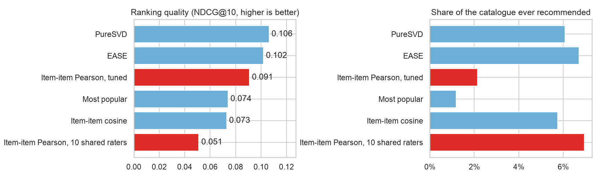
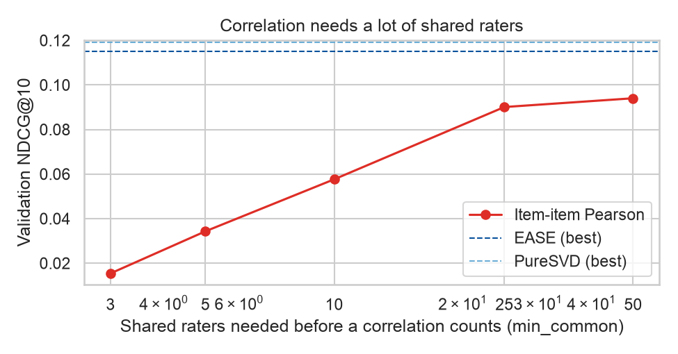

# Which movie recommender works best?

[](https://github.com/Sammyjoseph999/movie-recommender/actions/workflows/tests.yml)

A common first recommender takes a movie and recommends the movies whose ratings correlate most with it. This project measures how well that works against four alternatives on MovieLens. The question is the one a recommender is actually asked: given what someone has rated so far, which ten movies should they see next?

## Results

Each user's latest 20% of ratings are held out. A recommendation is a hit if the user later rated that movie 4 stars or more. 590 users are scored, and each model's settings are tuned on a separate split inside the training data.

| Model | Precision@10 | Recall@10 | NDCG@10 | vs. most popular | Catalogue covered |
|---|---|---|---|---|---|
| Most popular | 0.056 | 0.074 | 0.074 | | 1% |
| Item-item cosine | 0.056 | 0.083 | 0.073 | -1% | 6% |
| Item-item Pearson, 10 shared raters | 0.042 | 0.052 | 0.051 | -31% | 7% |
| Item-item Pearson, tuned (50 shared raters) | 0.072 | 0.096 | 0.091 | +23% | 2% |
| **PureSVD** (20 factors) | **0.083** | **0.120** | **0.106** | **+44%** | 6% |
| EASE (L2 = 300) | 0.082 | 0.117 | 0.102 | +38% | 7% |



- **The two linear models win clearly**, ranking the movies people go on to like about 40% better than a list of the most popular movies.
- **Correlation, built the usual way, loses to popularity.** With 10 shared raters per pair it scores 31% below the popularity list. Tuned to 50 shared raters it beats popularity, but only by recommending blockbusters (2% of the catalogue).
- **Popularity is a hard baseline.** It recommends barely 1% of the catalogue, and item-item cosine only ties it.
- **Personalisation matters most for light users.** For users with fewer than about 60 ratings the linear models beat popularity by roughly 50% to 80%; for heavier users, by about 30%.

### Why correlation struggles

A correlation between two movies is computed over the people who rated both, and for most pairs that is only a few people. With a threshold of three shared raters, *The Matrix* comes out "most similar" to *Nebraska*, *Spartan* and a Louis C.K. special, each rated by three to five people. Raising the threshold fixes the lists but rules out most of the catalogue.



## Models

| Model | Idea |
|---|---|
| Most popular | The same list for everyone: the most-rated movies the user has not seen |
| Item-item cosine | Movies watched by the same people as the user's movies |
| Item-item Pearson | Movies whose ratings correlate with those the user rated 4 stars or more |
| PureSVD | Truncated SVD of the ratings matrix, unrated entries as zero ([Cremonesi et al., 2010](https://dl.acm.org/doi/10.1145/1864708.1864721)) |
| EASE | A linear item-to-item model with a closed-form solution ([Steck, 2019](https://arxiv.org/abs/1905.03375)) |

All five are written with NumPy and SciPy, each in a few lines, in `recommender/models.py`. Both linear models train in seconds here.

## Layout

```
recommender/data.py      download, time-based split, user-by-movie matrix
recommender/models.py    the five recommenders and item-similarity lookup
recommender/metrics.py   precision, recall, NDCG and coverage at N
notebook.ipynb           the comparison
tests/                   unit tests on small hand-made ratings
```

## Data

MovieLens `ml-latest-small` (100,836 ratings, 610 users, 9,742 movies, 1996 to 2018) from [GroupLens](https://grouplens.org/datasets/movielens/). F. Maxwell Harper and Joseph A. Konstan, *The MovieLens Datasets: History and Context*, ACM TiiS 5(4), 2015. The notebook downloads it into `data/` on first run; it is not redistributed here, under GroupLens's terms of use.

## Running it

```bash
pip install -r requirements.txt
jupyter notebook notebook.ipynb
pytest -q
```

## Limits

- 610 users is small. Differences of a few thousandths in NDCG are noise; the gaps between groups of models are not.
- Splitting each user's history by time still lets a model learn from other users' later ratings. A single global cut-off date would be stricter.
- Only ratings are used. Genres, tags and release years would help most where data is thinnest: new movies and new users.
- EASE stores an item-by-item matrix, which becomes the limit with hundreds of thousands of movies; there a factorisation model is the practical choice.

## License

The code is released under the [MIT License](LICENSE). MovieLens data is subject to the GroupLens terms of use.
